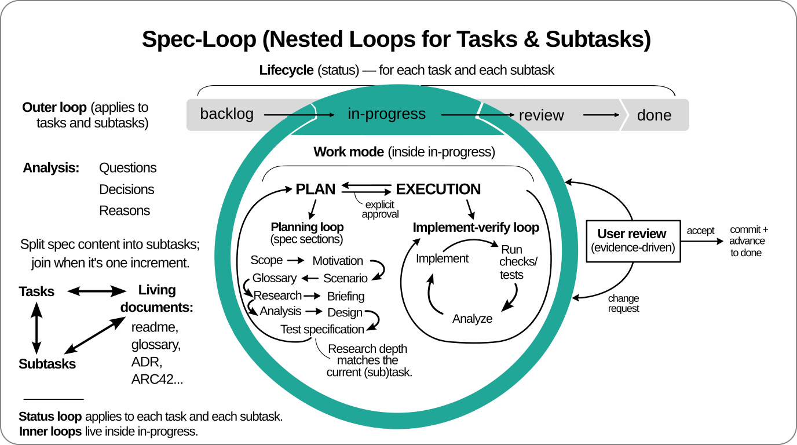

# Spec Loop — Design-First AI-Assisted Development

<p align="center">
  <a href="docs/infographics.svg">
    
  </a>
</p>

There are two common ways people use AI for coding.

**Vibecoding:** you describe intent, the model fills in the gaps, and you get a
large diff with undocumented decisions. Review becomes archaeology. Tests are
optional by accident.

**Waterfall:** you try to avoid that by writing a complete spec first. You
can’t. Constraints appear during implementation. The spec inflates, then it
either blocks change or gets ignored.

Spec Loop avoids both: write the next small spec, review it, then implement it
with tests. Keep the spec local to the next step. Repeat until done.

Living project documents record current specifications, contracts,
architecture, operations, shared language, and decisions. Spec Loop plans
changes to affected documents with the code, completes them in the same
increment, and includes them in review. Spec Loop does not require a project
to create living documents when none are otherwise needed.

Projects with multiple living documents keep one list in an existing
project instruction file or, by default, the root README. The list may point
to individual documents or collections such as an arc42 document set. An
existing project glossary remains active when it is the only living document.

When work is too large for one task, Spec Loop can use subtasks or
multiple task files / backlog items. Implementation tasks and subtasks
should be releasable unless the user explicitly opts out.

A task file is the default. If a lighter form meets the rules, the agent
explains why and asks your permission to use it. When that form is no
longer enough, the agent changes form and follows the new form's rules.
Chat-only tasks have exactly three sections: Scope (including constraints
and relevant context), Design, and Test specification. Only task files
use the full format. Agreeing to a form does not approve execution; the
agent must still ask before starting the work.

Spec Loop is a framework of reusable skills.

## Living Project Documents

This section is this project's authoritative living-project-document list.
`README.md` is implicit because it contains the list.

- [`AGENTS.md`](AGENTS.md) — project instructions; repository-wide agent
  rules.
- [`skills/`](skills/) — normative skill collection; Spec Loop workflow,
  format, and lifecycle behavior.
- [`docs/`](docs/) — user-facing documentation collection; explanations,
  governance, comparisons, studies, and tutorials.
- [`site/`](site/) — documentation publication collection; site navigation
  and build behavior.

## Getting Started

### Install the skills with `npx skills`

Recommended path:

Install the core task-workflow skills together, including
[spec-loop-write-readable-tests](skills/spec-loop-write-readable-tests/).
It provides independently usable test design and writing guidance,
plus Spec Loop rules for task verification entries and readiness.

Ensure Node.js is available so `npx` works.

Install Spec Loop in the current project with:

```bash
npx skills add dpolivaev/spec-loop -s '*'
```

Variations:
- `-s '*'` installs all shipped skills.
- Remove `-s '*'` to select skills interactively instead of installing the full bundle. That lets you skip the optional [spec-loop-setup-doc-rendering](skills/spec-loop-setup-doc-rendering/) and [spec-loop-review-change](skills/spec-loop-review-change/) skills, and skip [spec-loop-write-glossary](skills/spec-loop-write-glossary/) when your project will not use a project glossary.
- Add `-g` for a global install.
- Use `-g --all` for a global, non-interactive install for all supported agents.

For selective, single-agent, or other installation variants, see
https://github.com/vercel-labs/skills.

### Prepare task and glossary rendering

Spec Loop task files use embedded PlantUML diagrams and may also
include Mermaid visual glossaries. Spec Loop project glossaries may
include Mermaid diagrams. Prepare your editor for reviewing rendered
task files and glossary files before continuing.

Automated test entries and task-file Design class diagrams show planned
changes from the task's starting state: **+** means add, **=** means reuse
unchanged, and **±** means modify. Containers/types and cases/members are
classified independently. These text markers are annotations, not
identifiers, implementation progress, or test results. Automated test
entries use bold markers. PlantUML wraps only each bold marker in
`<plain>` to prevent static-member underlining from changing its
appearance. Mermaid class diagrams use plain `+`, `=`, and `±` without
HTML or Markdown wrappers; see the
[diagram policy](docs/diagram-and-rendering-policy.md).

Ask the agent to use the [spec-loop-setup-doc-rendering](skills/spec-loop-setup-doc-rendering/) skill to
prepare your editor preview setup.

If you do not want to use the skill and prefer manual setup, use these
editor-specific references:
[VS Code-Based IDE Setup](skills/spec-loop-setup-doc-rendering/vscode-setup.md)
and
[JetBrains Setup Reference](skills/spec-loop-setup-doc-rendering/jetbrains-setup.md).

For example:

```text
Please use the `spec-loop-setup-doc-rendering` skill to help me
prepare my editor for reviewing rendered Spec Loop task files and
glossary files.

My coding harness may run in a terminal, but I review files in
<VS Code, Cursor, another VS Code-based IDE, or JetBrains>.
```

When an end-to-end rendering check is useful, the skill should also
suggest small Markdown and AsciiDoc probe files that exercise the
relevant diagram types, including a class diagram.

If you review files in VS Code, Cursor, or another VS Code-based IDE,
the same extension IDs and settings apply. When your editor exposes a
supported CLI command, you can also run the helper script directly
instead of asking an agent to use the skill. You can either run it from
a local checkout or download the current main-branch copy directly from
[`setup-vscode-server-based.sh`](https://raw.githubusercontent.com/dpolivaev/spec-loop/refs/heads/main/skills/spec-loop-setup-doc-rendering/scripts/setup-vscode-server-based.sh).
The script requires a supported editor CLI command on `PATH` (`code`,
`code-insiders`, `cursor`, `code.cmd`, `code-insiders.cmd`, or
`cursor.cmd`) and is intended for macOS, Linux, WSL, and Git Bash for
Windows. Other VS Code-based IDEs should apply the same extension IDs
and settings manually.

The helper automates only the server-based PlantUML preview path for
supported VS Code-based IDEs together with the AsciiDoc extension used
by Spec Loop glossaries. It does not automate the local-only PlantUML
path or JetBrains setup.

From a local checkout:

```bash
bash skills/spec-loop-setup-doc-rendering/scripts/setup-vscode-server-based.sh --check
bash skills/spec-loop-setup-doc-rendering/scripts/setup-vscode-server-based.sh --apply
```

Without a local checkout:

```bash
curl -fsSLO https://raw.githubusercontent.com/dpolivaev/spec-loop/refs/heads/main/skills/spec-loop-setup-doc-rendering/scripts/setup-vscode-server-based.sh
bash setup-vscode-server-based.sh --check
bash setup-vscode-server-based.sh --apply
```

### How to update

Project-level update:

```bash
npx skills update
```

Global update:

```bash
npx skills update -g
```

### Manual fallback when `npx` is unavailable

If `npx` is not available, clone or download this repository and copy
the core task-workflow skills from [skills/](skills/) into your agent's skills
directory. Keep that core bundle together:

- [spec-loop-plan-task](skills/spec-loop-plan-task/)
- [spec-loop-plan-work-breakdown](skills/spec-loop-plan-work-breakdown/)
- [spec-loop-clarify-task](skills/spec-loop-clarify-task/)
- [spec-loop-prepare-execution-approval](skills/spec-loop-prepare-execution-approval/)
- [spec-loop-implementation-flow](skills/spec-loop-implementation-flow/)
- [spec-loop-write-adr](skills/spec-loop-write-adr/)
- [spec-loop-write-readable-tests](skills/spec-loop-write-readable-tests/)

The testing skill can also be used without the task-workflow bundle.

Install [spec-loop-write-glossary](skills/spec-loop-write-glossary/) when your project uses a project glossary.

Install [spec-loop-setup-doc-rendering](skills/spec-loop-setup-doc-rendering/) only if you want rendering setup or troubleshooting help.

Install [spec-loop-review-change](skills/spec-loop-review-change/) only if you need review of an existing
change, whether as a high-level assessment, a file-wise walk-through,
or both.

Which directory your agent uses is agent-specific. See
https://github.com/vercel-labs/skills for agent-specific installation details.

## Further Reading

- [How Spec Loop Works](docs/how-spec-loop-works.md) — why the
  workflow scales to large codebases.
- [Skills Overview](docs/skills-overview.md) — the skill catalog,
  reading path, and reference links.
- [Diagram and Rendering Policy](docs/diagram-and-rendering-policy.md)
  — PlantUML default, Mermaid fallback, and rendering guidance.
- [Governance, Review, and Traceability](docs/review-responsibility-and-traceability.md)
  — approval boundaries, review discipline, and traceability rules.
- [AI Workflow Framework Comparison](docs/skill-framework-comparison.md)
  — workflow trade-offs compared with other frameworks.
- Tutorials:
  - [Wordle Tutorial](docs/wordle-tutorial.md)
  - [Online Art Game Tutorial](docs/online-art-game-tutorial.md)

## License

Licensed under the MIT License. See [LICENSE](LICENSE.md).

## Origin

This framework was developed and applied in
Freeplane.
