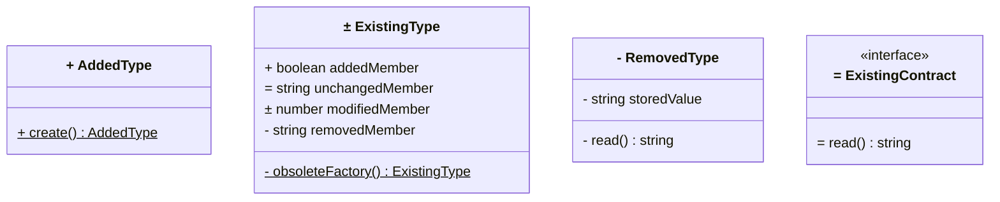

# Diagram and Rendering Policy

Spec Loop treats diagrams as specification artifacts: they make design
intent reviewable at the same boundary as the surrounding text.

Where the task-file path guidance requires diagrams in task files, use
PlantUML by default.

Mermaid is a poorer but still possible alternative when the User or
another governing instruction explicitly prefers Mermaid, for example
when GitHub or similar environments are used and PlantUML is not
rendered.

PlantUML remains the recommended default in practice because it is
usually easier to keep precise and reviewable for the structural and
behavioral design work used in Spec Loop.

## Planned changes in Design class diagrams

Task-file Design class diagrams use **+** for additions, **=** for
unchanged reuse, **±** for modifications, and **-** for removals relative
to the task's starting state. Removed elements remain visible for review,
not as retained target structure.

[Task-file Path Guidance](../skills/spec-loop-plan-task/task-file-path-guidance.md#planned-changes-in-design-class-diagrams)
defines the normative rules: scope, independent type/member
classification, exact starting-state declarations for removals,
modification versus replacement, target relationships, and
renderer-specific formatting.

### PlantUML

Wrap only each bold marker in `<plain>`, for example
`<plain>**-**</plain>`. This prevents static-member underlining from
changing the marker's appearance. Keep `{static}` and actual visibility
modifiers; see the normative rules above for syntax and rendering pitfalls.

### Mermaid

Use plain indicators without HTML or Markdown wrappers, and keep `$`
for static members. This example covers added, unchanged, modified, and
removed types and members, including a removed static method:

Illustrative starting context: `AddedType` and its factory are new.
`ExistingType` gains `addedMember`, retains `unchangedMember`, and changes
`modifiedMember`; it removes `removedMember` and the static
`obsoleteFactory()`. `RemovedType` and both its members are removed.
`ExistingContract` and its method are reused unchanged.

## Rendering

For inline PlantUML rendering in Markdown on the web, view the repo on
[GitLab](https://gitlab.com/dpolivaev/spec-loop). GitHub does not
render PlantUML embedded in Markdown natively, so reading there can
degrade the intended experience.

For local preview setup, use the
[spec-loop-setup-doc-rendering](../skills/spec-loop-setup-doc-rendering/) skill.
If you do not want to use the skill and prefer manual setup, use these
editor-specific references:
[VS Code-Based IDE Setup](../skills/spec-loop-setup-doc-rendering/vscode-setup.md)
and
[JetBrains Setup Reference](../skills/spec-loop-setup-doc-rendering/jetbrains-setup.md).
