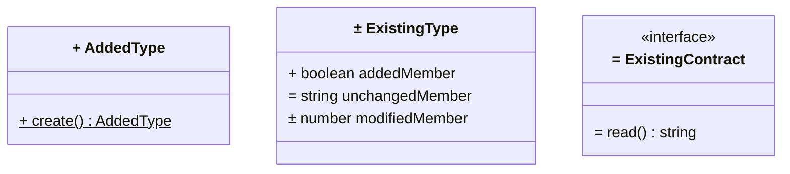

# Diagram and Rendering Policy

Spec Loop treats diagrams as specification artifacts: they make design
intent reviewable at the same boundary as the surrounding text.

Where the task-file path guidance requires diagrams in task files, use
PlantUML by default.

Mermaid is a poorer but still possible alternative when the User or
another governing instruction explicitly prefers Mermaid, for example
when GitHub or similar environments are used and PlantUML is not
rendered.

PlantUML remains the recommended default in practice because it is
usually easier to keep precise and reviewable for the structural and
behavioral design work used in Spec Loop.

## Planned changes in Design class diagrams

Task-file Design class diagrams prefix every displayed type and member
with a text marker relative to the task's starting state: **+** for
an addition, **=** for unchanged reuse, and **±** for modification.
Types and members are classified independently: an existing type gaining
a member is **±**, the new member is **+**, and unchanged members remain
**=**. Reusing an existing framework type does not make it new.

The notation includes interfaces, enums, type aliases, module boxes used
to show functions, and all displayed members. It decorates display labels
without changing canonical names, signatures, stable connector aliases,
packages, or relationships. It is not implementation progress or test
results. Do not use it in Research, component, sequence, or glossary
diagrams, or add notes, legends, or worded status labels inside task
diagrams.

### PlantUML

In PlantUML, wrap every bold marker, including type-label and non-static
member markers, as `<plain>**+**</plain>`, `<plain>**=**</plain>`, or
`<plain>**±**</plain>`. Wrap only the marker, not the whole declaration;
keep `{static}` and actual visibility modifiers before it in their
syntactic positions.

A bare `+` at the start of a PlantUML member means public visibility;
`~` means package visibility, so `~+` is not a literal-plus escape there.
Bare `**+**` is bold, but a static member also underlines it, which can
make it look like **±**. `<plain>` prevents the marker's underline while
preserving the static declaration's underline. Keep `{static}`; do not
remove it to avoid the rendering pitfall. This wrapping syntax is
PlantUML-specific.

### Mermaid

Mermaid `classDiagram` uses plain literal `+`, `=`, and `±` indicators in
quoted type labels and member rows. Keep simple ASCII class IDs unchanged.
Do not wrap indicators in HTML or Markdown: `<b>` tags can render
literally in member rows. Class headings follow the renderer's styling;
member indicators do not need to be bold.

Keep the `$` suffix on static fields and methods. Static-member
underlining may extend through the indicator, unlike PlantUML's isolated
marker. A leading `+` also has Mermaid public-visibility syntax; do not
infer source visibility from a planned-addition indicator.

Illustrative starting context: `AddedType` and its factory are new.
`ExistingType` gains `addedMember`, retains `unchangedMember`, and changes
`modifiedMember`; `ExistingContract` and its method are reused unchanged.
The same Design-only scope and independent type/member classification
apply to both renderers. PlantUML remains the default; use Mermaid only
when explicitly selected by the user or a governing instruction.

The normative rule is in
[Task-file Path Guidance](../skills/spec-loop-plan-task/task-file-path-guidance.md#planned-changes-in-design-class-diagrams).

## Rendering

For inline PlantUML rendering in Markdown on the web, view the repo on
[GitLab](https://gitlab.com/dpolivaev/spec-loop). GitHub does not
render PlantUML embedded in Markdown natively, so reading there can
degrade the intended experience.

For local preview setup, use the
[spec-loop-setup-doc-rendering](../skills/spec-loop-setup-doc-rendering/) skill.
If you do not want to use the skill and prefer manual setup, use these
editor-specific references:
[VS Code-Based IDE Setup](../skills/spec-loop-setup-doc-rendering/vscode-setup.md)
and
[JetBrains Setup Reference](../skills/spec-loop-setup-doc-rendering/jetbrains-setup.md).
